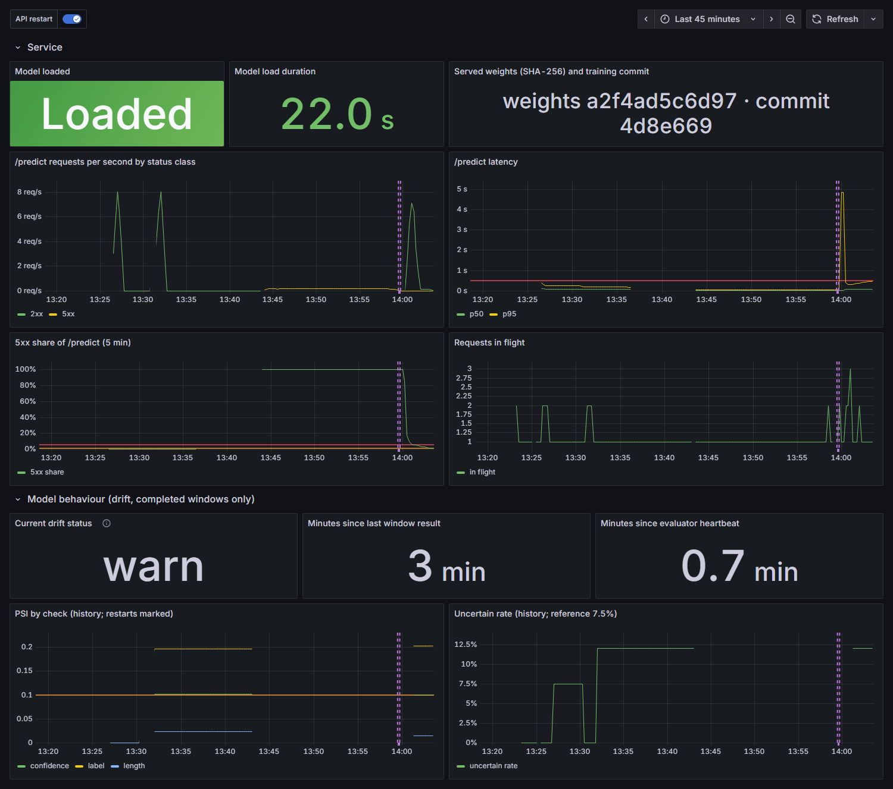

# Medical Specialty Triage System

[](https://github.com/show20130831/Medical-Specialty-Triage-System/actions/workflows/ci.yml)

**Suggests which of eight medical specialties a clinical description belongs to, and
says "uncertain" when a person should decide instead.**

A fine-tuned PubMedBERT model behind a FastAPI service, built end to end: data pipeline,
statistical evaluation, release gate, monitoring, and rehearsed incident response.

> Research and engineering prototype. Not for clinical use; no diagnosis, urgency
> assessment, or treatment advice.


## Overview

| | |
| --- | --- |
| **Problem** | Routing a clinical description to a specialty is a classification task where a confident wrong answer is worse than no answer. |
| **Solution** | Returns the top three specialties with calibrated confidence and abstains below a threshold validated on held-out data. |
| **Model** | PubMedBERT fine-tuned on 1,986 unique MTSamples descriptions; CPU inference. |
| **Scope** | English clinician-written descriptions; eight specialty groups. |

## Results

Test sets contain only descriptions never seen in training.

| Model | Macro F1, 6 data splits | Served model (95% CI) |
| --- | --- | --- |
| TF-IDF + logistic regression (baseline) | 0.761 ± 0.022 | 0.742 [0.691, 0.785] |
| **PubMedBERT** | **0.876 ± 0.012** | **0.889 [0.857, 0.919]** |

- **Beats the baseline on every split** (mean +0.115 macro F1; McNemar p < 0.001).
- **Abstention works:** answering 92.5% of inputs raises accuracy from 88.4% to 91.6%.
- **Honest headline:** on labels that do not come from keyword rules, accuracy is
  85.5%, the conservative estimate ([evaluation report](reports/model_evaluation.md)).

## Highlights

**Data quality: found and removed leakage.** 40% of labeled rows were duplicates, so the
original split let the model memorise test answers (99% on seen rows, 41% on rows with
conflicting labels). The pipeline now deduplicates, resolves label conflicts, and
validates that no description crosses splits.

**Evaluation that does not flatter.** Bootstrap intervals, paired significance tests,
three training seeds, and six data splits. The originally reported score turned out to
be the best of six splits, so the README leads with the mean.

**A release gate that blocks better-looking models.** Every model bundle must pass
offline metrics, 43 behavioural test cases, and a latency check. Two retrained
candidates with *higher* F1 were rejected for failing behavioural checks.

**Monitoring designed for privacy.** Prometheus metrics never expose text or
per-specialty counts; drift is computed inside the service over 400-prediction windows,
a size chosen after 100-prediction windows raised false alarms 64% of the time.

**Failure modes rehearsed, not just documented.** Each drill is written up with
timings and fixes:

| Drill | What happened |
| --- | --- |
| Normal traffic | No alert; live drift monitoring reproduced the offline reference |
| Model missing | Alerts fired in 2 and 7 minutes; **exposed a bug (500 instead of 503), now fixed** |
| Unfamiliar traffic | Drift alert 19 seconds after the window completed |
| Overload | Latency alert after about 6 minutes; cleared after load stopped |
| Release and rollback | Candidates rejected by the gate; restore from archive exposed a missing file, now fixed |

## Architecture

```text
 Training (GPU)                    Serving (CPU, Docker)                    Operations
 ─────────────                     ─────────────────────                    ──────────
 MTSamples                         FastAPI ── /predict, /version            Prometheus ── 8 alert rules
   → clean, label, deduplicate       │        /health, /ready                 → Alertmanager → receiver
   → validated splits                ├─ PubMedBERT + calibration             Grafana dashboard
   → baseline + PubMedBERT           ├─ abstention threshold                Runbook, drills,
   → evaluation report    ──gate──▶  ├─ in-process drift windows            change control
   → private model archive           └─ /metrics (no text) ──────────────▶
```



## Quick Start

Requires Docker and the model bundle in `models/pubmedbert_description/` (trained with
the [pipeline](docs/training.md); the weights are private because the training data has
no stated license).

```bash
docker compose up --build                       # API at http://127.0.0.1:8000
docker compose --profile monitoring up --build  # adds Grafana at http://127.0.0.1:3000
```

Local Python setup, API reference, and tests: [docs/development.md](docs/development.md).

## Documentation

| Document | Contents |
| --- | --- |
| [Product design](docs/product-design-and-plan.md) | Scope, data, evaluation, architecture, risks |
| [Training](docs/training.md) | Reproducible pipeline and data decisions |
| [Validation and operations](docs/validation-and-operations.md) | Release gate, monitoring, runbook, change control |
| [Operations plan](docs/operations-plan.md) | Monitoring design, SLOs, alerting, drills |
| [Drill records](docs/operations/drills/) | What was injected, detected, and fixed |
| [Reports](reports/) | Evaluation, release gate, split variation, load test |
| [Development](docs/development.md) | Setup, API, testing, CI, repository layout |

## Tech Stack

PyTorch · Hugging Face Transformers · scikit-learn · FastAPI · Docker · Prometheus ·
Grafana · Alertmanager · k6 · pytest · GitHub Actions

## Limitations

- Internal evaluation only: one data source and rule-assisted labels, no clinical review.
- No out-of-scope detection: 90% of descriptions from specialties outside the eight
  groups still receive a confident suggestion.
- Monitoring detects drift, not accuracy loss; no ground-truth labels arrive in use.
- Single-process CPU service: one concurrent client within the 500 ms p95 target on the
  development laptop. No authentication or public deployment.

## License

For educational and portfolio use.
