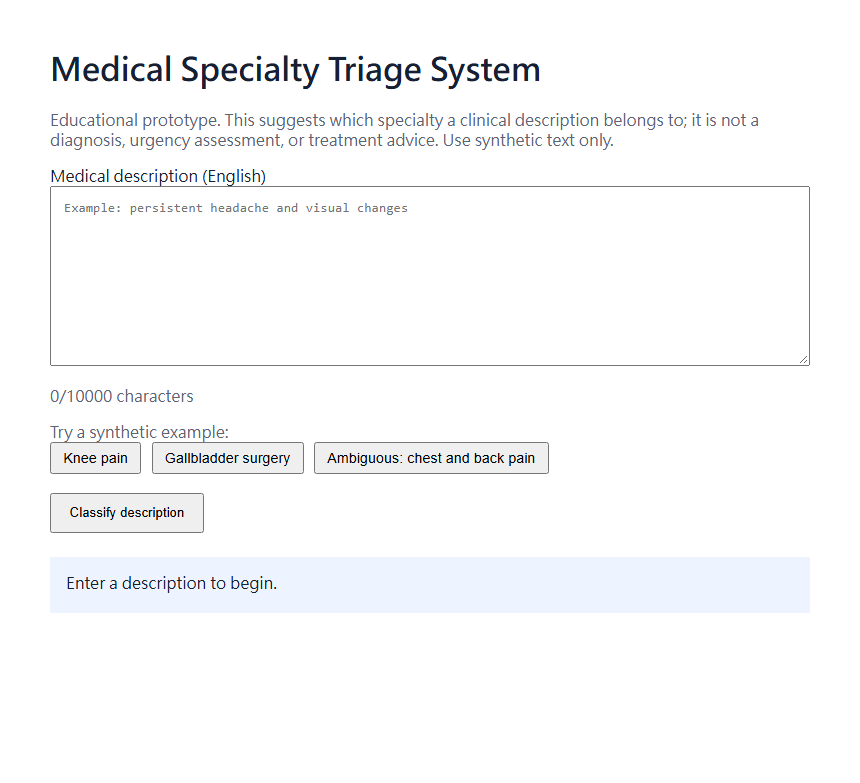
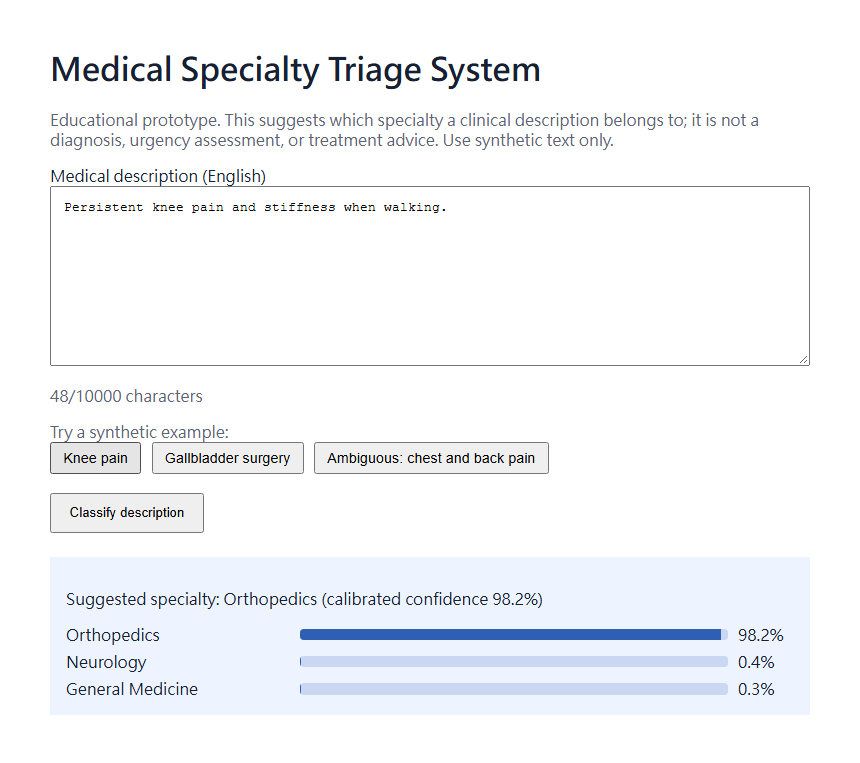
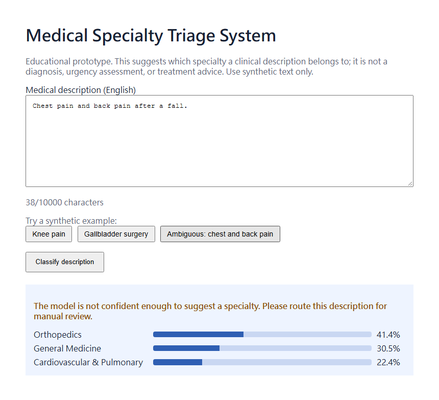

# Medical Specialty Triage System

An educational NLP application that suggests which of eight medical specialties an
English clinical description belongs to, with calibrated confidence and an "uncertain"
answer when the model should defer to a person.

The project covers the full ML workflow: a reproducible data and training pipeline with
leakage-free splits, a statistically evaluated PubMedBERT model, a FastAPI service with a
browser interface, Docker packaging, automated tests, and CI.



## Current Status

The application runs locally with the fine-tuned model on CPU.

```text
Browser -> FastAPI -> PubMedBERT (CPU) -> top-3 specialties + calibrated confidence
                                        -> "uncertain" below the validated threshold
```

The trained weights are kept in a private Hugging Face repository because the MTSamples
training data does not state a license, so neither the data nor the weights are
redistributed and no public online demo is hosted. Given access to the dataset and
compliance with its source's terms, the training pipeline reproduces the model in a few
minutes on one GPU; see [docs/training.md](docs/training.md).

| Confident prediction | Uncertain prediction |
| --- | --- |
|  |  |

## Features

- Classifies description-only input into eight specialties and returns the top three.
- Reports temperature-calibrated confidence and marks low-confidence inputs as
  `uncertain` using a threshold chosen on validation data.
- Serves a same-origin browser interface at `/`.
- Exposes `/predict`, `/health`, `/ready`, `/version` (served weights hash, training
  commit, calibration), and `/metrics` (aggregate counters only) endpoints.
- Loads the local model once per API process in CPU evaluation mode.
- Accepts descriptions up to 1,000 characters (training maximum 433), so nothing is
  truncated; rejects blank or longer input with `422` and oversized bodies with `413`;
  returns `503` when the model is unavailable.
- Release gate, drift check, runbook, and change control for the model; see
  [Validation and Operations](#validation-and-operations).
- Logs request metadata without logging medical text.
- Provides Docker and Docker Compose configuration.

## Technology

- Python 3.10+
- FastAPI and Uvicorn
- PyTorch CPU
- Hugging Face Transformers
- PubMedBERT fine-tuned for description classification
- Pytest
- Docker
- GitHub Actions

## Quick Start

Create the environment and install the API and test dependencies:

```powershell
python -m venv .venv
.\.venv\Scripts\python.exe -m pip install -e ".[test]"
```

Install CPU inference dependencies:

```powershell
.\.venv\Scripts\python.exe -m pip install "torch==2.14.0" --index-url https://download.pytorch.org/whl/cpu
.\.venv\Scripts\python.exe -m pip install -e ".[inference]"
```

Place a model bundle at `models/pubmedbert_description/`: either train one with
[docs/training.md](docs/training.md) or, with access to the private Hugging Face repository,
run `hf download show20130831/medical-specialty-pubmedbert --local-dir models/pubmedbert_description`.

Set the model path and start the API:

```powershell
$env:TRIAGE_MODEL_DIR = (Resolve-Path ".\models\pubmedbert_description").Path
$env:TRIAGE_HOST = "127.0.0.1"
$env:TRIAGE_PORT = "8000"
.\.venv\Scripts\python.exe -B -m triage_system
```

Open http://127.0.0.1:8000/ in a browser.

## API Example

```powershell
$body = @{ description = "Persistent knee pain and stiffness when walking." } | ConvertTo-Json
Invoke-RestMethod -Method Post -Uri http://127.0.0.1:8000/predict `
  -ContentType "application/json" -Body $body
```

Example response:

```json
{
  "label": "Orthopedics",
  "score": 0.9825,
  "uncertain": false,
  "top": [
    {"label": "Orthopedics", "score": 0.9825},
    {"label": "Neurology", "score": 0.0043},
    {"label": "General Medicine", "score": 0.0029}
  ]
}
```

Scores are softmax outputs after temperature scaling fitted on validation data
(`calibration.json` in the model bundle). When the top score falls below the
validated threshold, `uncertain` is `true` and the browser asks for manual review; on
the test split this withholds 7.5% of inputs and raises accuracy on the rest from
88.4% to 91.6%.

| Condition | Status |
| --- | --- |
| Prediction returned | `200` |
| Blank or over 1,000 characters | `422` |
| Request body over 16 KB, or without `Content-Length` | `413` / `411` |
| Model not configured or failed to load | `503` |

## Validation and Operations

Before release, `python -m triage_training validate-model` checks a bundle against
[configs/release_criteria.yaml](configs/release_criteria.yaml): offline metrics, 43
synthetic behavioural cases, and CPU latency. The served bundle passes
([release report](reports/release_validation.md)).

In use, `/metrics` exposes aggregate counters only (no text, no per-request records), and
`python -m triage_training monitor-drift` compares a snapshot with the bundle's test-set
reference. Replaying the test split reports OK; traffic from specialties the model never
learned reports only WARN, which shows how weakly out-of-scope input surfaces
([demo](reports/drift_demo/)). Without ground-truth labels, drift is a signal of change,
not proof of lower accuracy.

The runbook, rollback procedure, and retraining rules are in
[docs/validation-and-operations.md](docs/validation-and-operations.md).

## Docker

The container does not include model weights. Mount the private export read-only through Docker Compose:

```powershell
docker compose up --build
```

The browser interface is available at http://127.0.0.1:8000/. Stop the container with:

```powershell
docker compose down
```

## Model Development

The classifier is trained by the `triage_training` package from the public Kaggle
MTSamples dataset: cleaning, taxonomy labeling, deduplication, leakage-free stratified
splits, data validation, a TF-IDF baseline, and PubMedBERT fine-tuning, all driven by
[configs/train.yaml](configs/train.yaml). See [docs/training.md](docs/training.md).

```bash
python -m triage_training prepare-data
python -m triage_training baseline
python -m triage_training finetune
```

### Results

Test split of 398 unique descriptions that never appear in training. Intervals are 95%
bootstrap intervals; full analysis in [reports/model_evaluation.md](reports/model_evaluation.md).

| Model | Test accuracy | Test macro F1 |
| --- | --- | --- |
| TF-IDF + logistic regression | 0.744 [0.701, 0.786] | 0.742 [0.691, 0.785] |
| PubMedBERT (seed 42, served) | 0.884 [0.854, 0.915] | 0.889 [0.857, 0.919] |
| PubMedBERT, 3 training seeds | | 0.892 ± 0.003 (mean ± SD) |
| PubMedBERT, 6 data splits | | **0.876 ± 0.012** (0.858–0.889) |
| TF-IDF + logistic regression, 6 data splits | | 0.761 ± 0.022 (0.738–0.788) |

The served split happens to be PubMedBERT's best of six, so 0.876 is the more
representative figure ([split variation](reports/split_variation.md)).

- PubMedBERT beats the baseline by +0.148 macro F1 [+0.107, +0.192]; exact McNemar
  p < 0.001. It wins on every one of six data splits (mean +0.115, smallest +0.071).
- Splitting rows instead of unique descriptions put 365 identical descriptions in both
  train and test. On that split, test rows seen in training scored 99% (memorised) and
  rows with conflicting labels 41%, so its 0.80 macro F1 mixed both effects. This is why
  the pipeline deduplicates before splitting.
- Rows labeled by keyword rules score 93%, directly mapped rows 86%: for 87% of
  keyword-rule rows the description contains a keyword of its own label, so part of the
  headline score reflects the labeling rules. **86% on directly mapped rows is the more
  conservative estimate.**
- These are internal results (same source, same labeling rules). No external
  validation has been done, and `uncertain` does not detect out-of-scope input: 90% of
  descriptions from excluded specialties still received a confident label.

## Testing

```powershell
.\.venv\Scripts\python.exe -B -m pytest -q -p no:cacheprovider
.\.venv\Scripts\python.exe -m pip check
```

The test suite covers API behavior, input validation, model asset validation, offline CPU loading contracts, prediction logic, configuration, privacy-safe logging, and the training data pipeline (labeling, deduplication, split validation, baseline). Training tests use synthetic data, so CI needs neither the dataset nor a GPU. CI runs the test suite on Windows and Ubuntu with Python 3.10.

## Engineering Highlights

- Model assets are validated before loading, without reading weight bytes during metadata checks.
- Model loading is local-only with remote code disabled and safetensors enabled.
- `/health` remains independent from model availability; `/ready` reports model readiness.
- The model is cached after the first load and reused for subsequent requests.
- Request logs contain method, path, status, and duration, but never request bodies.
- Model weights, medical data, notebooks, and virtual environments are excluded from Git.
- Changes land through pull requests on a ruleset-protected `main`; CI runs tests on
  Ubuntu and Windows, serves a tiny model bundle end to end, and builds the Docker image.
- The container runs as a non-root user with a health check; host and port settings are
  validated at startup by `python -m triage_system`.

## Limitations

- Educational prototype, not a clinically validated system.
- English description input only.
- Specialty classification is not diagnosis, urgency assessment, or treatment advice.
- Calibration and the `uncertain` flag hold for descriptions like the training data.
  Vague or out-of-scope text (for example "Follow-up visit.") can still receive a
  confident label: 90% of descriptions from excluded specialties do. The model has no
  out-of-distribution detection.
- CPU inference is intended for demonstration and small-volume testing.
- Public deployment, authentication, rate limiting, and capacity testing are not
  implemented. Monitoring measures drift, not accuracy in use.

## Project Structure

```text
src/triage_system/
├── __main__.py         # Service entry point with validated settings
├── api.py              # FastAPI routes and browser entry point
├── config.py           # Environment-backed settings
├── monitoring.py       # Aggregate prediction metrics
├── model_assets.py     # Local export validation
├── model_loader.py     # Offline CPU model loading
├── predictor.py        # Description inference
├── logging_config.py   # Privacy-safe request logging
└── web/index.html      # Browser client
src/triage_training/
├── data.py             # Cleaning, labeling, deduplication, split validation
├── baseline.py         # TF-IDF + logistic regression
├── finetune.py         # PubMedBERT fine-tuning and export
├── report.py, stats.py # Statistical evaluation report
├── release.py          # Release gate
├── drift.py            # Drift check against the reference profile
└── __main__.py         # CLI for all of the above
configs/                # Training, taxonomy, release criteria, monitoring thresholds
reports/                # Evaluation, release, and drift reports (aggregates only)
scripts/                # Traffic simulation for the drift demonstration
tests/                  # Automated tests and synthetic behavioural cases
Dockerfile              # Reproducible CPU image
compose.yaml            # Local container startup
```

## License

This project is intended for educational and portfolio use.
