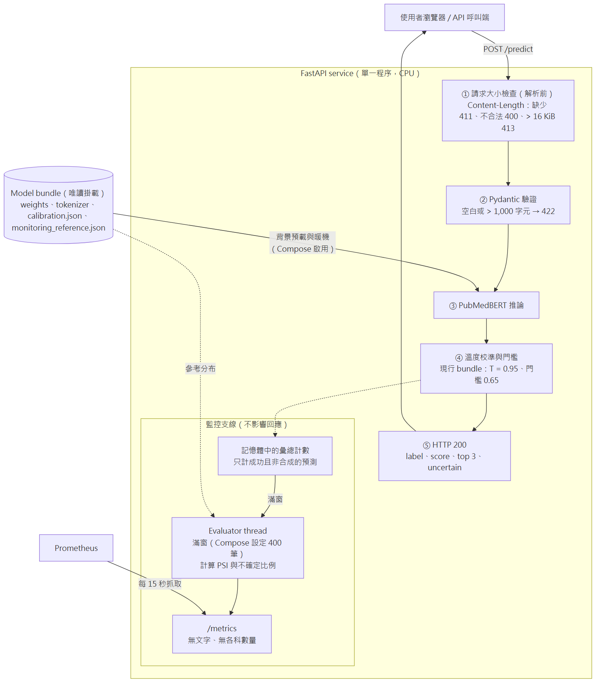
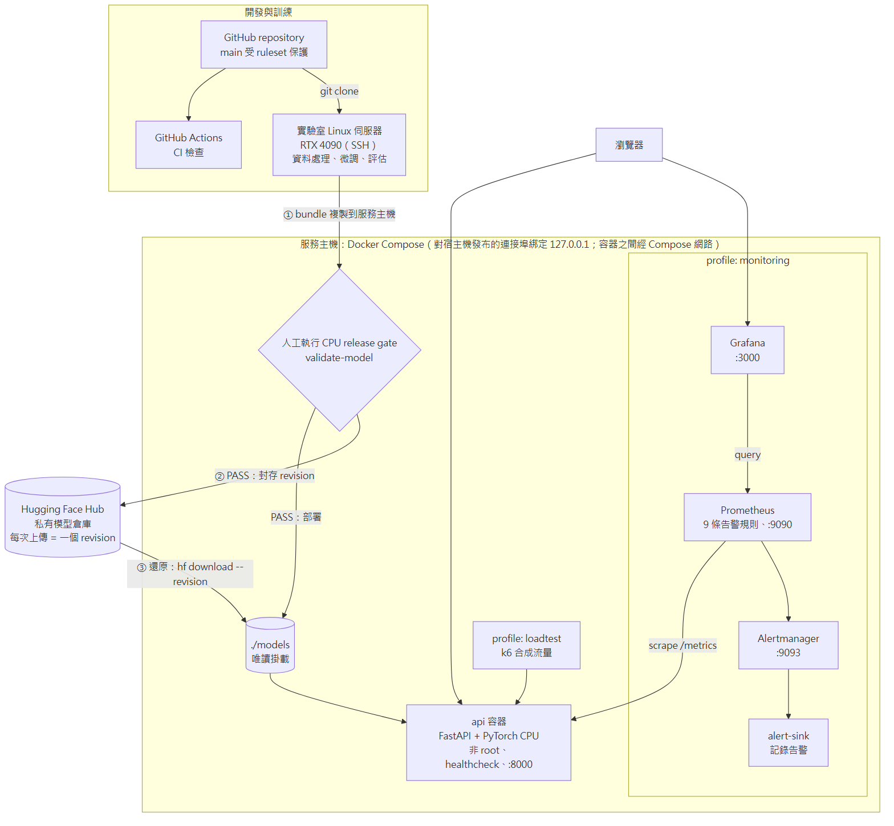
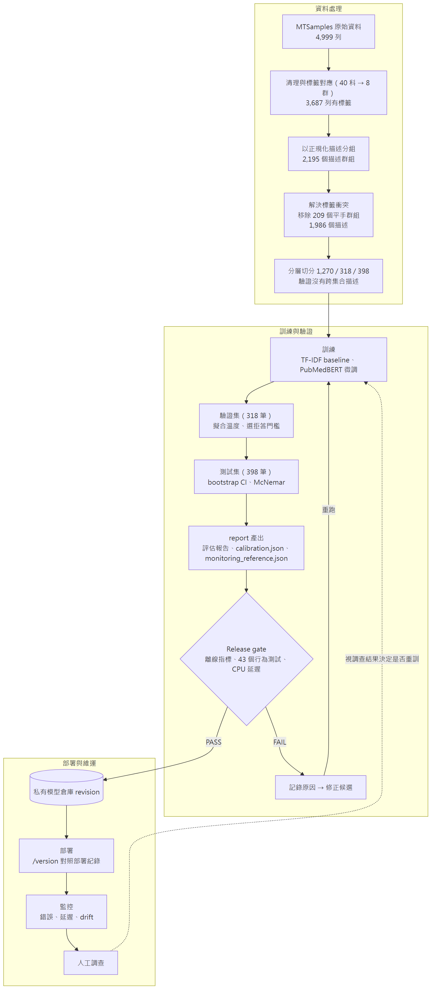
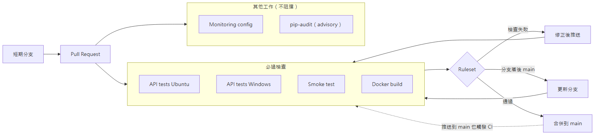

# Medical Specialty Triage System：系統設計與架構說明

- **展示方式**：未公開部署；在本機以 Docker Compose 執行。操作畫面見 [README 的示範動畫](../README.md)
- **程式語言**：Python 3.10。模型使用 PyTorch 與 Hugging Face Transformers，服務使用 FastAPI
- **架構圖**：[docs/diagrams/output/](diagrams/output/)（PNG），原始檔在 [docs/diagrams/src/](diagrams/src/)（Mermaid）

> 研究與工程原型，不供臨床使用；不做診斷、急迫性判斷或治療建議。

## 一、程式用途

醫療單位常需要把一段臨床描述轉給對應的專科。這是一個分類問題，但和一般分類不同的是：
**有把握地分錯，比不回答更糟**。分錯的案件會被送到錯誤的科別，而且沒有人會再檢查。

本系統讀入一段英文臨床描述，建議它屬於 8 個專科群組中的哪一個，並回傳前三名與經過校準的信心。
信心不足時，系統把結果**標記為不確定**（`uncertain`），提示由人員判斷；系統本身沒有實作轉派流程。

本次交付的重點不只是模型，而是一個模型從資料到上線、再到維運的完整流程：

- **資料**：清理、標籤對應、去重複，並驗證訓練集與測試集之間沒有資料洩漏。
- **模型**：微調 PubMedBERT，並以 TF-IDF＋邏輯迴歸作為比較基準。
- **驗證**：以統計方法比較模型；上線前必須通過 release gate。
- **部署與維運**：容器化服務、監控與告警、演練，以及回滾程序。

## 二、主要功能

| 功能 | 說明 |
| --- | --- |
| 專科建議 | 輸入一段臨床描述，回傳最可能的專科、校準後的信心，以及前三名 |
| 標記不確定 | 最高信心低於門檻時，回應仍包含科別與前三名，只是多了 `uncertain: true`；網頁把主訊息改為「建議人工判斷」，下方仍列出前三名。測試集上答覆率 92.5%，答覆部分的準確率 91.6%（全部作答時為 88.4%） |
| 版本識別 | `GET /version` 回報正在服務的權重 SHA-256、訓練 commit 與校準參數，可對照部署紀錄 |
| 健康檢查 | `/health` 只檢查服務存活；`/ready` 確認模型已載入、能夠回答 |
| 監控指標 | `/metrics` 提供 Prometheus 指標：請求數、延遲、錯誤、模型狀態與 drift 結果；不含任何輸入文字，也不含各科數量 |
| 分布漂移偵測 | 累積固定數量的真實預測後，與模型的參考分布比較，回報 OK、WARN 或 ALERT |
| 告警與儀表板 | 9 條 Prometheus 告警規則經 Alertmanager 送出；Grafana 儀表板呈現目前狀態 |
| 網頁介面 | 服務根路徑 `/` 提供簡單的瀏覽器介面 |

畫面與程式碼使用英文。

## 三、系統架構

### 3.1 系統如何運作

以輸入「Persistent knee pain and stiffness when walking.」為例，一次預測的流程如下：

1. **檢查請求大小**：解析 JSON 之前，先檢查 `Content-Length` 標頭：缺少時回傳 411，格式不合法回傳 400，
   宣告大小超過 16 KiB 回傳 413。
2. **檢查內容**：解析後由 Pydantic 驗證描述，空白或超過 1,000 字元回傳 422。
3. **模型推論**：Compose 設定會在服務啟動時於背景預先載入模型，並暖機一次，以減少第一個請求的延遲
   （開發筆電上一次實測約 28 秒）。預載完成前到達的 `/ready`、`/version` 或 `/predict` 請求，會等待同一個載入流程，
   不會重複載入。PubMedBERT 在 CPU 上計算各科分數。
4. **校準與標記**：分數依 bundle 中的 `calibration.json` 做溫度校準，轉成信心；最高信心低於門檻時標示 `uncertain`。
   現行 bundle 的值為 T = 0.95、門檻 0.65（來源見第五節）。
5. **回傳結果**：HTTP 200，內容包含 `label`、`score`、前三名 `top` 與 `uncertain`，例如 `Orthopedics 0.98`。
6. **記錄彙總計數**：成功、且沒有標為合成流量的預測，只以「計數」累加到記憶體中的 drift 視窗，不保存文字。
   帶有 `X-Synthetic-Traffic: 1` 標頭的請求（壓力測試、探測）照常回答，但不計入視窗。
7. **漂移檢查**：視窗滿了之後交給背景的 evaluator thread，與參考分布比較，結果寫到 `/metrics` 後丟棄計數。
   這個檢查失敗不會影響任何預測回應。

**錯誤狀態**：模型未設定、檔案缺失或載入失敗時回傳 503，表示「服務暫時無法回答」；推論過程中程式捕捉到的錯誤回傳 500。

### 3.2 系統部署在哪裡

| 層級 | 元件 | 說明 |
| --- | --- | --- |
| 使用者層 | 瀏覽器 | 使用網頁介面或直接呼叫 API；另外可開啟 Grafana 儀表板 |
| 存取層 | 本機 `127.0.0.1` | 對宿主機發布的連接埠都只綁定本機：API 8000、Grafana 3000、Prometheus 9090、Alertmanager 9093；容器之間經 Compose 網路通訊。沒有對外公開，也沒有登入機制 |
| 應用層 | `api` 容器 | FastAPI 單一程序、PyTorch CPU；以非 root 身分執行；Docker healthcheck 檢查 `/health`；背景預載模型並暖機 |
| 模型層 | `./models` 目錄 | 唯讀掛載進容器；映像中不含模型權重，換模型或回滾只需切換目錄 |
| 監控層 | Prometheus、Alertmanager、alert-sink、Grafana | 以 Compose profile `monitoring` 啟動；Prometheus 每 15 秒抓取 `/metrics`，以 volume 保存彙總指標 15 天；告警經 Alertmanager 送到 alert-sink 記錄 |
| 測試層 | k6 | 以 Compose profile `loadtest` 啟動，送出合成流量做壓力測試 |
| 訓練環境 | 實驗室 Linux 伺服器（RTX 4090） | 透過 SSH 執行資料處理、微調與評估；每次訓練在 `run_manifest.json` 記錄訓練 commit |
| 模型封存 | Hugging Face Hub 私有倉庫 | 通過 release gate 的 bundle 上傳後成為一個 revision；部署與回滾都以 `hf download --revision` 取得指定版本 |
| 原始碼與交付 | GitHub、GitHub Actions | `main` 受 ruleset 保護；CI 只做測試、建置與設定檢查，不部署，也不持有任何憑證 |

訓練 commit 與服務映像的 source commit 分開記錄在 [deploy/current.json](../deploy/current.json)。兩者可以不同：
例如修正服務程式後重建映像，模型仍是同一份權重。

## 四、服務選用原因

選擇服務的原則是「**只採用這個專案真正需要的元件，並讓每個版本都能追溯**」。
這個專案的特性是：模型需要 GPU 訓練，但推論只需要 CPU；訓練資料沒有標示授權；
輸入是醫療文字，因此盡量不保存，也不能出現在監控資料中。

| 需求 | 選用 | 原因 |
| --- | --- | --- |
| 模型訓練 | **實驗室 GPU 伺服器（RTX 4090）** | 微調 PubMedBERT 需要 GPU，每次只需幾分鐘；使用既有的實驗室資源不需費用。`run_manifest.json` 記錄 commit、設定、資料雜湊與套件版本，換一台機器也能重現 |
| 模型封存 | **Hugging Face Hub 私有倉庫** | 免費、原生支援 Transformers 模型格式；每次上傳自動成為一個 revision，可依 revision 下載，正好用來回滾 |
| 執行服務 | **Docker 容器＋Docker Compose** | 同一個映像在開發機、CI 與任何主機上行為一致；Compose 以 profile 區分「只有 API」與「API＋監控」，不必另外維護兩套設定 |
| API 框架 | **FastAPI** | 以 Pydantic 宣告輸入格式與長度限制，自動回傳 422；與 Python 的模型程式同一個語言，不需要再包一層 |
| 監控與告警 | **Prometheus、Alertmanager、Grafana（自行架設）** | 開源、免費，設定檔與告警規則都放在 Git 中並由 CI 驗證；任何主機都能以 Compose 重現同一套監控，不綁定特定雲端 |
| 壓力測試 | **k6** | 以腳本描述負載，結果可輸出成 JSON，便於寫成報告 |
| 持續整合 | **GitHub Actions** | 與程式碼放在同一個平台，每個 Pull Request 自動檢查；可同時在 Ubuntu 與 Windows 上測試 |

**為什麼沒有公開部署？** 這是專案的決策：

- **授權**：MTSamples 沒有標示授權，因此權重放在私有倉庫，不公開提供以它訓練出的模型。
- **展示方式**：原本規劃使用 Hugging Face Spaces，但建立 Docker Space 需要付費方案；改為本機執行，並以 README 的示範動畫呈現。
- **用途**：這是研究原型，沒有登入、沒有速率限制，也沒有臨床審查，不適合讓任何人送入醫療文字。

因此本專案把重點放在「**任何主機都能以同一份設定重現**」：映像、Compose 設定、監控規則與部署紀錄都在 Git 中。
若之後要上雲，做法見第十二節。

**為什麼沒有應用資料庫？** 這是原型的範圍取捨。目前 API 只做即時推論與漂移監控，因此沒有建置保存逐筆請求的資料庫；
服務仍有請求日誌（不含輸入文字）與背景 evaluator，Prometheus 也會保存彙總指標。

- **得到的**：不留存醫療文字，減少敏感資料外洩的風險。
- **放棄的**：無法回查個別案件；也無法把預測和經審查的正確科別配對，評估模型在哪些情境下分錯。
  若要做到這兩件事，需要保存輸入、模型版本與預測，並同時處理存取控制與保存期限。

**沒有使用的服務**：沒有對外的金鑰，也沒有需要排程的工作，因此不需要快取、訊息佇列或金鑰管理；
模型以 CPU 推論，服務端也不需要 GPU。

## 五、資料與模型設計

訓練程式位於 [src/triage_training/](../src/triage_training/)，約 2,000 行；每個步驟都是一個指令，
例如 `python -m triage_training prepare-data`。詳細說明見 [training.md](training.md)。

**資料清理與驗證。**

| 步驟 | 數量 |
| --- | --- |
| 原始資料 | 4,999 列 |
| 移除缺少專科或描述的列，依 [configs/taxonomy.yaml](../configs/taxonomy.yaml) 把原始專科對應到 8 個群組；只有符合直接對應或關鍵字規則的列才取得標籤 | 3,687 列有標籤 |
| 以正規化後的描述（大小寫、標點、空白）分組 | 2,195 個描述群組（1,492 列是重複） |
| 解決標籤衝突：409 個群組有衝突，200 個依規則保留，209 個平手而整組移除 | 1,986 個不重複描述 |
| 分層切分，並檢查類別數量、空白文字，以及沒有任何描述跨越兩個集合 | 訓練 1,270 / 驗證 318 / 測試 398 |

**衝突的處理規則**：群組中只要有直接對應的標籤，就只計直接對應的票；沒有時才計關鍵字規則的票。最高票平手時，整組移除。

**洩漏實驗。** 為了說明去重複的必要，另外以「逐列切分」（不去重複）訓練一次做比較。
測試列中，訓練集出現過、且標籤一致的描述，準確率高達 98.8%，代表模型是在背答案；
訓練集出現過的測試列整體為 77.2%，標籤有衝突的子集只有 41.3%，因為這些描述本來就沒有唯一的正確答案。

**模型。** 以 TF-IDF＋邏輯迴歸作為基準，再微調 PubMedBERT（以醫學文獻預訓練的 BERT）。
所有超參數放在 [configs/train.yaml](../configs/train.yaml)，設定檔中有未知或型別錯誤的欄位就拒絕執行。

**統計驗證。** 兩組實驗分開進行，回答不同的問題：

| 實驗 | 做法 | 回答的問題 | 結果 |
| --- | --- | --- | --- |
| 資料切分的影響 | 訓練設定固定，以切分 seed 1–5 與 42 重新做分層切分，共 6 次 | 結果是否只是切分運氣好 | Macro F1 0.876 ± 0.012（平均 ± 標準差），基準模型 0.761 ± 0.022；6 次都優於基準，平均 +0.115，最少 +0.071 |
| 訓練隨機性 | 固定切分 42，以 3 個訓練 seed 重複訓練 | 結果是否只是訓練運氣好 | Macro F1 0.892 ± 0.003（[評估報告](../reports/model_evaluation.md)） |
| 現行模型 vs 基準 | 切分 42 上的 paired bootstrap 與 McNemar 檢定 | 差異是否顯著 | 現行模型 macro F1 0.889 [0.857, 0.919]（95% CI）；McNemar p < 0.001 |
| 保守估計 | 只看直接對應（非關鍵字規則）的標籤 | 標籤由規則產生是否灌水 | 準確率 85.5% |

6 次切分都來自同一個資料來源與同一套標註流程，屬於內部驗證，不代表在其他資料上的表現。
原本回報的分數其實是 6 次切分中最好的一次，因此文件以平均值作為主要結果。

**校準與門檻。** 兩者都只用 318 筆驗證資料決定，再到測試集上檢驗：

1. 以最小化 NLL 擬合溫度 T，現行 bundle 為 0.95。
2. 以校準後的最高信心由低往高掃描門檻，選出**第一個**讓已答覆樣本準確率達到 90% 的值，現行 bundle 為 0.65。
3. 測試集上答覆率 92.5%，已答覆樣本準確率 91.6%。

`report` 指令把這兩個值寫入 `calibration.json`，並產生 `monitoring_reference.json`（測試集的預測分布，供漂移偵測使用），
兩者都隨 bundle 一起發布。推論時：`calibration.json` 不存在就使用 T = 1.0 並停用門檻；檔案存在但內容不合法則拒絕載入模型。

門檻並不穩定：對驗證集做 bootstrap 重抽時，選出的門檻在 0.00 到 0.71 之間變動。保留目前的門檻是有記錄的決策，
改善方法見第十二節。

## 六、服務設計

服務程式位於 [src/triage_system/](../src/triage_system/)，約 900 行。

| 模組 | 職責 |
| --- | --- |
| `config.py`、`__main__.py` | 讀取並驗證環境變數，以 `python -m triage_system` 啟動 |
| `model_assets.py`、`model_loader.py` | 檢查模型 bundle 的檔案與校準設定，載入模型並計算權重雜湊 |
| `predictor.py` | 推論、溫度校準與不確定標記 |
| `monitoring.py` | Prometheus 指標、drift 視窗、evaluator thread |
| `api.py` | 路由、請求大小檢查、錯誤處理、背景預載與暖機 |
| `logging_config.py` | 日誌設定；日誌不記錄輸入文字 |

**啟動時驗證。** 設定錯誤（例如連接埠不是數字）服務直接拒絕啟動。模型目錄不存在或檔案不完整時，
服務仍會啟動，`/health` 正常，但 `/ready` 與 `/predict` 回傳 503，告警會在幾分鐘內觸發。

**並行安全。** 背景預載與早到的請求可能同時要求模型，以鎖加上二次檢查，確保模型只載入一次。

**API。**

| 路徑 | 用途 |
| --- | --- |
| `POST /predict` | 對一段描述做預測 |
| `GET /health` | 存活檢查，不載入模型 |
| `GET /ready` | 模型已載入且可以回答 |
| `GET /version` | 權重 SHA-256、訓練 commit、校準參數 |
| `GET /metrics` | Prometheus 指標 |
| `GET /` | 網頁介面 |

| 狀況 | 狀態碼 |
| --- | --- |
| 回傳預測（包含標記為不確定） | 200 |
| `Content-Length` 格式不合法 | 400 |
| 缺少 `Content-Length` | 411 |
| 宣告的請求大小超過 16 KiB | 413 |
| 描述空白或超過 1,000 字元 | 422 |
| 推論時發生程式捕捉到的錯誤 | 500 |
| 模型未設定、缺失或載入失敗 | 503 |

## 七、發布與部署流程

**Release gate。** 每個模型 bundle 上線前，由操作者執行 `python -m triage_training validate-model`，
依 [configs/release_criteria.yaml](../configs/release_criteria.yaml) 依序檢查：

1. **身分核對**：評估報告必須來自產生這個 bundle 的同一次訓練（核對訓練執行時間與 commit）。
2. **離線指標**：測試集 macro F1 ≥ 0.85；相對基準的提升，信賴區間下限 > 0；每一科 F1 ≥ 0.75；
   校準後 ECE ≤ 0.08；答覆準確率 ≥ 90%、答覆率 ≥ 85%。
3. **行為測試**（43 個合成案例）：

   | 類型 | 數量 | 標準 |
   | --- | --- | --- |
   | 明確案例 | 24 | 全部答對，且不標記為不確定 |
   | 表面文字變體（大小寫、標點、空白） | 9 | 全部維持原本的科別 |
   | 模糊案例 | 5 | 至少 4 個標記為不確定 |
   | 範圍外案例 | 5 | 只記錄、不判定，因為系統沒有範圍外偵測 |

4. **延遲**：直接呼叫 CPU 推論函式，暖機 5 次後計時 50 次，p95 ≤ 500 ms。現行 bundle 的 p95 約 67 ms。

任何必過項目不合格，指令產生 FAIL 報告並以狀態碼 1 結束，由操作者暫停部署；修正候選模型後重跑 gate，標準不會為了讓模型通過而放寬。
500 ms 是互動式服務的工程目標，不是由臨床需求推導出的數字。

**這個 gate 的限制**：5 個模糊案例中，有 4 個是在看過現行模型的表現之後才選入的，因此這組測試偏向現行版本。
演練 D4 中，兩個以不同 seed 重新訓練的候選模型 F1 **較高**，卻都沒有通過：兩者的模糊案例都未達標（5 個中只有 2 個與 3 個標記為不確定），
seed 1 另外答錯 1 個明確案例。模糊案例的失敗一部分可能來自上述偏差。後續需要建立事先決定、與現行模型無關的拒答測試集。

**部署步驟**：

1. 在 GPU 伺服器訓練與評估，把 bundle 複製回服務主機。
2. 在服務主機以 CPU 執行 release gate，產生 [reports/release_validation.md](../reports/release_validation.md)。
3. 通過後上傳到私有模型倉庫，記下 revision。
4. 以 `docker compose up -d api` 啟動；容器在背景預載模型並暖機。
5. 確認 `GET /version` 的權重雜湊與部署紀錄一致，並更新 [deploy/current.json](../deploy/current.json)。

**回滾**（演練 D4 中實際執行；兩個候選都未部署，因此還原的是同一套現行權重）：

1. 先在新目錄下載要還原的 revision，現有版本繼續服務（約 75 秒，不會中斷）。
2. 以 `TRIAGE_MODEL_NAME=<目錄> docker compose up -d api` 切換；中斷時間為容器重啟與模型載入，演練中為 57–68 秒。
3. 以 `/version` 確認雜湊，再對還原的 bundle 重新執行 release gate，並記錄事件。

**重新訓練。** drift ALERT 連續兩個視窗、使用情境改變或有新的標註資料時，由人員調查；調查不會自動重訓或部署。
重訓的模型必須通過同一個 release gate；更改分類架構或標籤則需要完整重新審查。
完整規則見 [validation-and-operations.md](validation-and-operations.md)。

## 八、監控與告警

**漂移視窗。** Compose 掛載的設定（[configs/monitoring.yaml](../configs/monitoring.yaml)）以 400 筆成功、且沒有標為合成流量的預測為一個視窗；
沒有指定設定檔時，程式預設為 100 筆。視窗滿了之後交給背景執行緒，計算與參考分布的 PSI，並檢查不確定比例：

| 訊號 | 判斷標準（WARN / ALERT） | 能看出什麼 |
| --- | --- | --- |
| 預測科別分布的 PSI | 0.10 / 0.25 | 案件組成改變，或收到範圍外的輸入 |
| 信心分布的 PSI | 0.10 / 0.25 | 輸入和訓練資料越來越不像 |
| 輸入長度分布的 PSI | 0.10 / 0.25 | 出現新的文件類型 |
| 不確定比例 | 15% / 25%（參考值 7.5%） | 模糊或陌生的輸入變多 |
| 錯誤率、延遲、模型狀態 | Prometheus 告警規則 | 服務或容量問題 |

bundle 缺少 `monitoring_reference.json` 時仍可推論，但漂移狀態會一直是「尚未評估」。

**為什麼視窗是 400 筆。** 以沒有漂移的驗證集模擬，100 筆的視窗有 64% 會誤報 WARN；400 筆降到 4.6%
（[估算報告](../reports/drift_window_estimate.md)）。代價是偵測較慢，流量低時更常出現「資料不足」。

**隱私設計。** 指標中沒有輸入文字，也沒有各科的數量。原因是：如果兩次讀取指標之間只有一筆預測被計入，
比較兩次的各科計數就能知道那一筆被分到哪一科。模型行為只以「最近一個完成視窗的 drift 結果」呈現。

**誠實的狀態。** 每次啟動後狀態為「尚未評估」，視窗 24 小時內沒有填滿則為「資料不足」；這兩種狀態本身不會觸發 drift WARN 或 ALERT，
但服務與 evaluator 的其他告警仍各自運作。因為使用中沒有正確答案回饋，這些訊號只能說明「輸入或輸出改變了」，不能證明準確率下降。

**告警規則**（9 條，[deploy/monitoring/alerts.yml](../deploy/monitoring/alerts.yml)）：服務停止、模型未載入、
錯誤率（警告與嚴重兩級）、延遲過高、drift WARN、drift ALERT、drift 檢查停滯、drift 檢查失敗。
每條規則都對應 [runbook](validation-and-operations.md#5-response-runbook) 中的處理步驟。

**演練。** 每種故障都實際注入一次並記錄時間與修正，記錄在 [docs/operations/drills/](operations/drills/)：

| 演練 | 結果 |
| --- | --- |
| D0 正常流量 | 沒有告警；線上 drift 結果與離線參考一致 |
| D1 模型遺失 | 告警分別在 2 分鐘與 7 分鐘觸發；**發現 `/predict` 回傳 500 而不是 503，已修正並加上回歸測試** |
| D2 陌生流量 | 視窗完成後 19 秒觸發 drift 告警 |
| D3 過載 | 約 6 分鐘後觸發延遲告警，負載停止後解除 |
| D4 發布與回滾 | 兩個候選模型被 release gate 擋下；從封存還原時**發現缺少 `monitoring_reference.json`，已補上** |

**兩種延遲量測。** 兩者量的東西不同，不能直接比較：

| 量測 | 方式 | 結果 |
| --- | --- | --- |
| Release gate | 直接呼叫 CPU 推論函式，單一請求 | p95 約 67 ms |
| 壓力測試（[報告](../reports/load_test.md)） | k6 經 HTTP 呼叫 Docker 內的 API，長短輸入混合，開發筆電 | 1 個並行用戶 p95 267–464 ms，符合 500 ms 目標；2 個並行用戶在 5 次測試中有 3 次達標；吞吐量約每秒 11–13 個請求飽和，先失守的是延遲而不是錯誤 |

## 九、持續整合（CI）

每個 Pull Request 與每次推送或合併到 main，GitHub Actions 都會執行以下工作：

| 工作 | 內容 | 合併必過 |
| --- | --- | --- |
| API tests（Ubuntu、Windows） | pytest 全部 116 項測試，各平台 115 項通過、1 項略過（這項工作沒有安裝 PyTorch，需要它的 smoke test 改由下一項工作執行）：狀態碼、輸入限制、模型檔案與校準驗證、不確定標記、隱私安全的日誌與指標、drift 視窗的並行與失敗隔離、資料處理、統計與 release gate | 是 |
| Service smoke test | 建立一個隨機初始化的小型 BERT bundle，驗證核心推論與監控路由：`/ready`、`/version`、`/predict`、`/metrics` | 是 |
| Docker build | 建置映像，確認以非 root 身分執行、`/health` 為 200、沒有模型時 `/ready` 為 503 | 是 |
| Monitoring config | 以 promtool 與 amtool 驗證告警規則、Prometheus 與 Alertmanager 設定，並檢查 Compose 檔 | 否 |
| Dependency audit | pip-audit 檢查已知漏洞；只提示、不阻擋合併，因為修正常需等待上游套件更新 | 否 |

訓練相關的測試使用合成資料，因此 CI 不需要資料集，也不需要 GPU。CI 只有讀取權限，不部署、不持有任何憑證。

## 十、Git 協作流程

本專案採用 main 加上短期分支（`feature/*`、`fix/*`、`docs/*`、`ci/*`、`chore/*`）的流程，並由 GitHub ruleset **強制執行**：

- 不能直接推送到 main，所有變更都透過 Pull Request；
- 四項必過檢查（Ubuntu 測試、Windows 測試、smoke test、Docker build）通過，且分支必須與最新的 main 同步才能合併；
- 禁止 force push。

檢查失敗時修正後重跑；分支落後 main 時先更新分支，再重跑檢查。PR 中說明目的、變更內容與測試結果；
合併後刪除分支是維護慣例，不是 ruleset 的要求。套件更新也以同樣流程處理，同一個套件在所有檔案中的版本一起更新。

## 十一、安全、隱私與成本

**安全與隱私**

- **輸入資料**：不保存輸入文字與預測結果；日誌與指標都不含文字，指標也不含各科數量。
- **存取**：對宿主機發布的連接埠只綁定本機；容器以非 root 身分執行，模型目錄唯讀掛載。
- **輸入限制**：以 `Content-Length` 在解析前拒絕超過 16 KiB 的請求；描述最多 1,000 字元。
- **模型與資料**：權重與訓練資料都不放進 Git 或映像；權重放在私有倉庫。
- **供應鏈**：主要依賴固定版本，部分訓練依賴（numpy、scipy）使用版本範圍；每次 CI 都以 pip-audit 檢查已知漏洞。

**成本**

- 訓練使用實驗室既有的 GPU，模型封存使用 Hugging Face 免費的私有倉庫，CI 使用 GitHub Actions 的免費額度。
- 服務與監控都在本機執行，沒有任何雲端費用。

## 十二、限制與未來擴充

**目前的限制**

- 只用一個資料來源評估，標籤部分由規則產生，沒有臨床人員審查。
- 不偵測範圍外的輸入：8 個群組以外的專科描述，有 90% 仍會得到有信心的答案。
- 監控只能偵測分布改變，無法直接量測準確率下降，因為使用中沒有正確答案回饋。
- 單一程序的 CPU 服務；在開發用筆電上只有 1 個並行用戶能穩定符合延遲目標。沒有登入，也沒有公開部署。

**若要成為實際產品，需要做以下調整**（尚未實作）：

- **取得可用的資料授權並進行臨床審查**，才能公開部署模型。
- **部署到託管的容器服務**（例如 Cloud Run 或 Azure Container Apps）：模型載入加上暖機需要數十秒，
  應保留至少一個常駐執行個體，避免冷啟動；記憶體與 CPU 規格需依實測決定。
- **加上身分驗證、速率限制與 HTTPS**，並把 CI 擴充為自動部署（CD）：通過 release gate 的 bundle 與映像以不可變的版本部署。
- **偵測範圍外的輸入**，例如以獨立的檢查拒絕 8 個群組以外的描述。
- **在有存取控制的前提下保存案件資料並收集經審查的標籤**，以便回查個案、量測使用中的真正準確率。
- **改善拒答門檻的穩定性**：需要更多驗證資料，並建立事先決定、與現行模型無關的拒答測試集。
